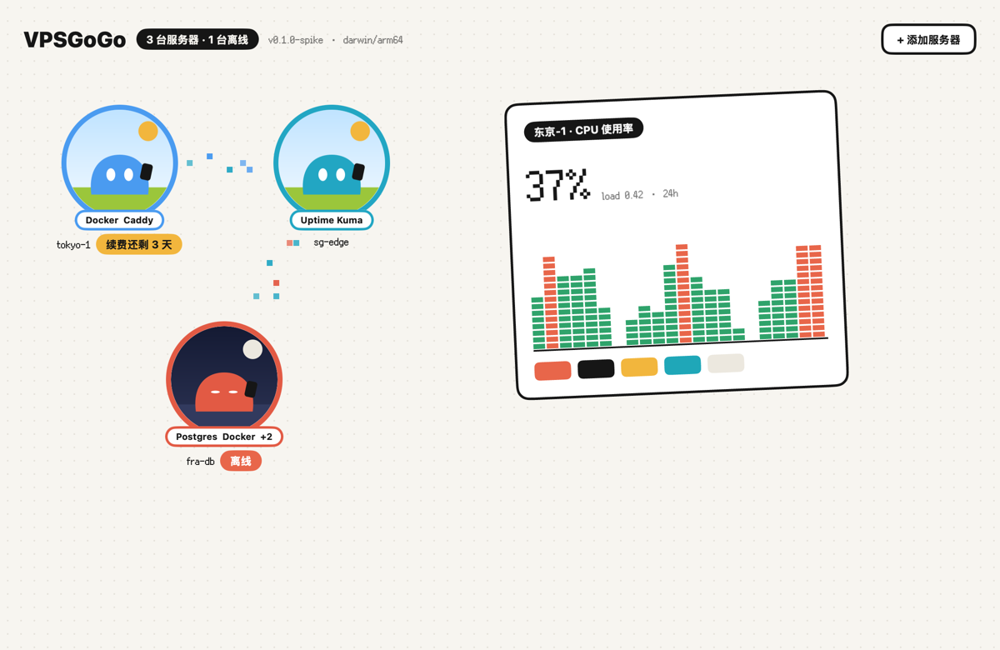
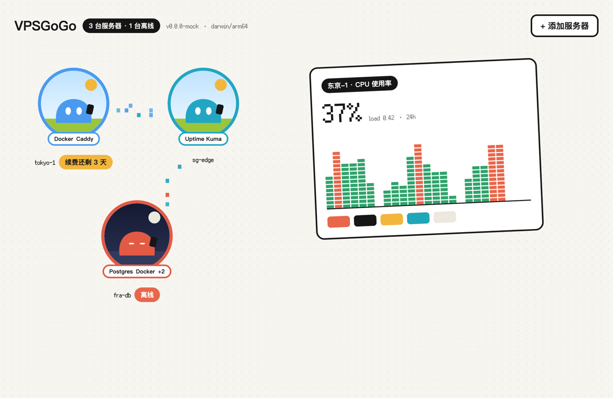
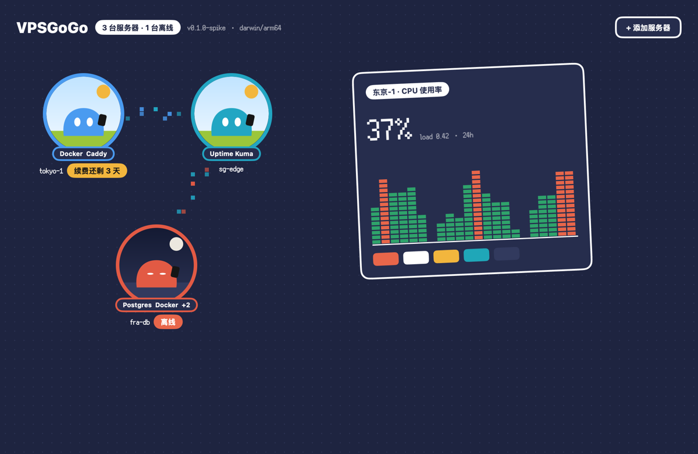
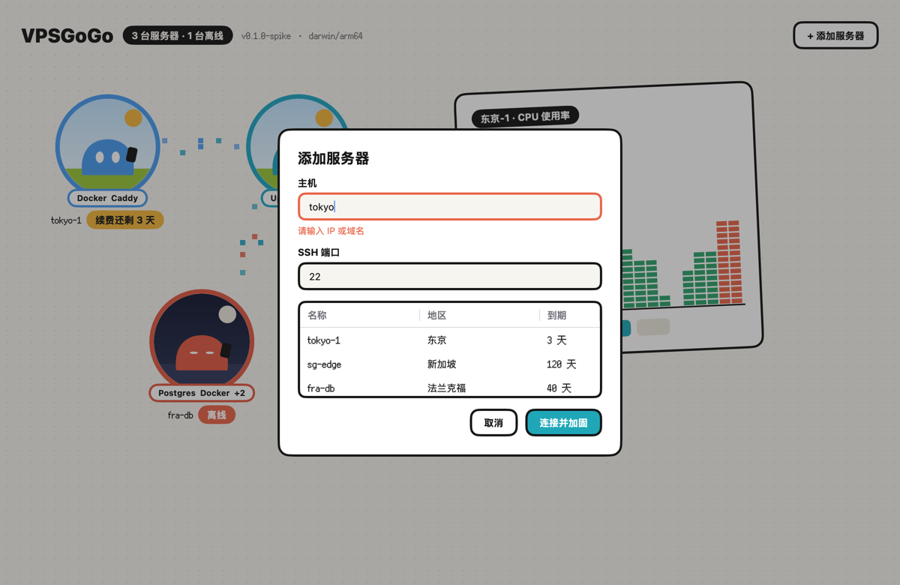

# 原生 UI 与 Web UI 对比实验

同一个场景，按 SPEC §9 做了两遍：
- 3 个服务器徽章：SVG 团子，带渐变和 clipPath，分白天和夜晚
- 像素粒子流
- 倾斜卡片：像素字体读数和像素柱状图
- 胶囊标签：中文与像素字体混排
- 「添加服务器」弹窗：输入框、校验、表格，统一改成 3px 墨线风格
- 异步加载的版本号

两边用同样的 token、同样的数据，窗口都是 1200×780，按 2x 截图。

实验代码没有合入仓库，这里只保留结论和截图（2x 截图缩到 1200 宽）：

| 原生 | Web |
|---|---|
|  |  |
|  | |
|  | |

**决定：切换到原生 UI**（见 SPEC §10）。

## 结论

原生 UI 能做出 SPEC §9 要的效果，截图和 web 版几乎看不出区别。视觉上没有发现阻塞问题。

在前台运行时，原生版内存比 web 版少约三分之一，CPU 差不多。窗口隐藏后两边都自动停止动画。中文输入法已手动验证可用。主要差别在开发体验。

## 指标

| | 原生 `ui` | Web（React） |
|---|---|---|
| 场景代码行数 | 347（Go + SVG） | 257（TSX + CSS） |
| 产物大小 | 二进制 11.7 MiB（只含 spike） | .app 11.9 MB（含 Go 后端和前端） |
| 窗口在前台、动画运行中：内存（`top` MEM） | 约 231 MiB，1 个进程 | 约 347 MiB，4 个进程相加（应用 38 + WebKit 两个进程 148、155 + Networking 6） |
| 窗口在前台、动画运行中：CPU | 22–25% | 17–23%（各进程相加） |
| 最小化或 Cmd+H 隐藏后：CPU | 0% | 0% |
| 最小化或 Cmd+H 隐藏后：内存 | 73–87 MiB | 约 125 MiB |
| 无窗口截图 | `Tester.Image()`，几秒跑完。我截了一次真实窗口的局部（被其他窗口部分遮挡），和无窗口截图对比，看不出差异 | 需要 headless Chrome 和 dev server |
| 深色模式、减少动态效果 | `Theme().Dark`、`Preferences().ReduceMotion` | CSS 媒体查询、`matchMedia` |

测量条件：每次只开一个应用，用 AppleScript 把窗口切到前台、最小化或隐藏，再用 `top -l 3 -s 3` 取最后一次采样。

- 之前测过两次，结论都不成立，已作废：
  - 启动 5 秒时用 `ps` RSS 测，结果是原生 131 MiB、web 254 MiB；
  - 后来又测了一次「稳态」，结果是 web CPU 0%、内存 133 MiB。那次 web 窗口其实不在前台，WebKit 暂停了动画。
- 隐藏时暂停动画不需要自己写代码。mygo 在窗口完全看不到时（最小化、隐藏、在别的桌面、被完全遮挡）会自动暂停动画帧，和浏览器一样（`ui/runtime.go` 的 `next` 和 `holdFrame`）。只有定时刷新的数据需要自己用 `c.WindowHidden()` 判断。
- 两边动画期间 CPU 都在 20% 左右。这主要是粒子动画每帧都重画整个场景造成的，与技术栈无关。M5 做常驻面板时要降低帧率，或者只重画粒子那一层。
- 两边动画不完全相同：原生版多了团子的呼吸和眨眼，web 版只有粒子。所以原生版的 CPU 数字略偏高。
- 冷启动时间没有测。

## SPEC §9 要求的能力

| 能力 | 原生 | Web |
|---|---|---|
| 像素字体（Fusion Pixel, OFL） | ✅ `RegisterFont` 实际能加载 woff，但文档只写了支持 TTF/OTF，正式使用时最好换成 TTF | ✅ @fontsource |
| 中文与像素字体混排、字形回落 | ✅ 中文自动回落到系统字体，基线正常 | ✅ |
| 倾斜 -2.5° 后文字清晰度 | ✅ 清晰 | ✅ |
| SVG 插画（渐变、clipPath） | ✅ 渲染正确 | ✅ |
| 在代码里改 SVG 颜色 | ⚠️ 要把颜色拼进模板字符串，每种颜色各解析一次 | ✅ 直接用 props 或 CSS 变量 |
| 像素粒子、像素图表 | ✅ 用 `Painter.Fill` 对齐 8px 网格 | ✅ canvas，需要手动处理 DPR |
| 弹窗、输入框、表格、按钮改成墨线风格 | ✅ 不能用 `Modal`（自带一层白色外框）和 `Button`（主题蓝），要改用 `DialogBase`、`TextInputBase`、`ButtonBase` 自己拼 | ✅ 原生 `<dialog>` 加 CSS |
| 团子动画：呼吸、`steps()` 眨眼 | ✅ 呼吸用 `Loop` + `Scale`；眨眼用预先解析好的闭眼 SVG 帧，在第 3.9 秒那一帧切换。没有内置 `steps()`，需要自己写一个约 3 行的 Easing。注意 `Loop` 在开启「减少动态效果」时不会自动停，要自己判断 | CSS `animation` + `steps()`，减少动态效果用一条媒体查询关掉（这次没写） |
| 异步数据 | goroutine 里拿到数据后调 `Services().Invalidate()`。没有 TanStack Query 那样的缓存、重试和加载状态，要自己写 | TanStack Query |

## 原生版需要的变通和摩擦

1. **文档就是源码注释。** 例子很多，但 API 要靠在 `api_gen.go` 里 grep 和看 examples 来学，比如：
   - `Align` 常量叫 `ui.Center`，不叫 `AlignCenter`；
   - `Key` 在 `Context` 上，不在 `Element` 上。

   我第一次编译就因为这类原因失败了 2 处。
2. **默认控件带系统主题外观。** 要做成我们的风格，每种控件都得基于 `*Base` 封装一层，相当于自建一个小组件库。这种做法和 shadcn 那套思路一致，工作量可以接受。
3. **SVG 不能按实例传参。** 团子有 8 种状态和 10 种颜色，可以启动时预先解析，或者用 SVG 内的 `var()` 加样式表来改色（mygo 支持，这次没试）。
4. **框架版本 v0.10。** `ui` 的 API 将来可能有破坏性变化。

## 还没验证

- 冷启动时间，以及 Linux、Windows 上的效果。

## 建议

视觉层面两边都能做到。

原生 UI 的好处：
- 只用 Go 一种语言；
- 不需要 bun、Vite、TS 工具链；
- 无窗口测试可以直接出图，以后 M5b 的截图验收会更简单；
- 终端插件可以直接用。

代价：
- 每种控件都要自己基于 `*Base` 封装；
- 没有 TanStack Query 这类现成工具；
- 框架还年轻，API 可能会变；
- 性能不是切换的理由：内存少约三分之一，CPU 差不多。

之前定的两个前提都已满足：中文输入法可用，窗口隐藏时 CPU 会自动降到 0。两边都没有硬性障碍。看重「只用 Go、测试简单」就切原生；看重开发速度和现成生态就留在 web。我倾向于原生。
